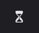
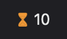
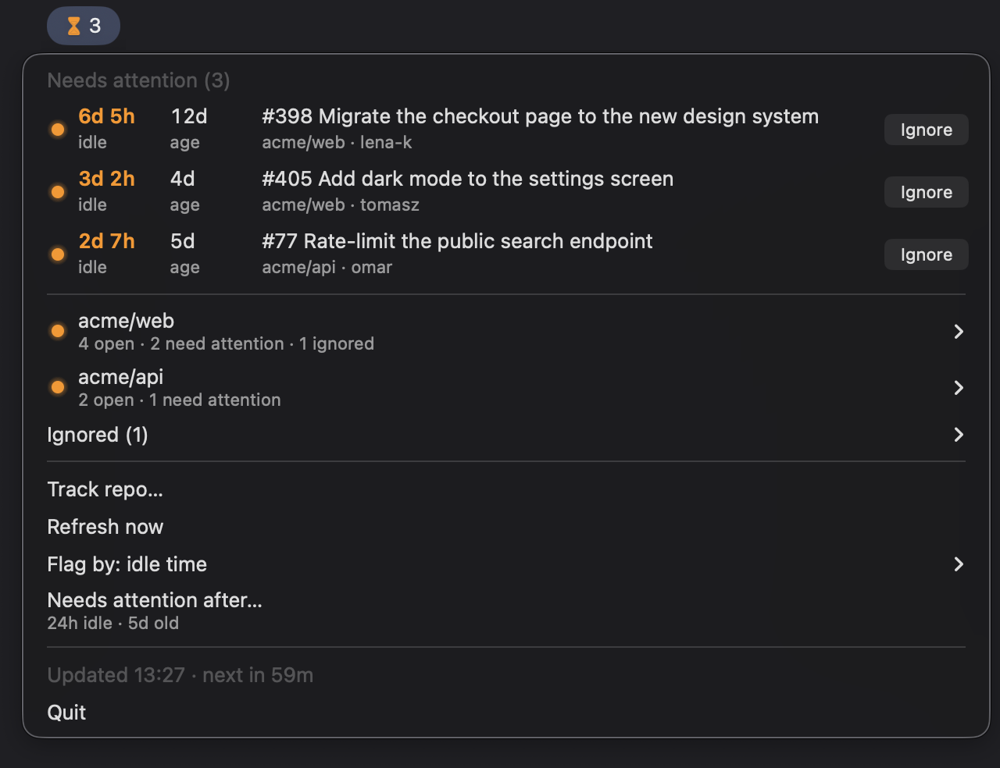

# menubar-pr-idle

Tracks the open pull requests of GitHub repos from the macOS menu bar (built with [rumps](https://github.com/jaredks/rumps)) and flags the ones nobody has touched for a while, or that have waited too long. The menu bar item stays a plain hourglass until a PR needs attention.

| Nothing to do | PRs need attention |
|---|---|
|  |  |



## Features

- **Tracked repos**: **Track repo…** pre-fills a repo URL from the clipboard; any github.com page in the repo works. Remove one with **Stop tracking** in its submenu.
- **Needs attention**: flags open PRs that had no commits, comments or reviews for a while (24 hours by default); the hourglass turns orange with a count. Change the time with **Needs attention after…**. See [Needs attention](#needs-attention).
- **Flag by age**: flags PRs by how long they've been ready for review instead (5 days by default), and sorts them oldest first. Pick **Flag by** → **Age** in the menu; set the days in **Needs attention after…**.
- **Attention list**: the flagged PRs of all repos at the top of the menu, most idle (or oldest) first. Click one to open it in the browser.
- **Repo view**: a submenu per repo with all its open PRs, each with how long it has been idle, its age, and its author.
- **Ignore**: hides a PR you don't need to watch, so it no longer counts or notifies, until it's merged or closed. Click **Ignore** on its row; undo it from the **Ignored** submenu.
- **Notifications**: when a PR needs attention.
- **Command line**: add and remove repos, pick what flags PRs and set the thresholds, from the terminal, also while the app runs.

## Needs attention

**Flag by** picks what makes an open, non-draft PR need attention:

- **Idle time** (the default): no activity for longer than the threshold, 24 hours by default. Activity is any of:
  - a commit or a force push
  - a comment, a review, or a reply in a review thread (comments and reviews by bots don't count)
  - the PR being opened, or marked ready for review
- **Age**: ready for review for longer than the threshold, 5 days by default, whatever happened on it. The age counts from when the PR was opened, or from the last time it was marked ready for review if it was a draft.

**Needs attention after…** opens one window with both thresholds: hours for idle time, days for age, decimals allowed. Its second line in the menu shows them. Only the one picked in **Flag by** applies. Switching doesn't notify about the PRs that need attention under the new setting. Ignored PRs never need attention.

The menu shows:

- **Needs attention**: those PRs across all repos, most idle (or oldest) first (up to 15).
- One submenu per repo with all its open PRs, sorted the same way, with the ones needing attention above a separator. Each PR shows how long it has been idle, its age, and its author. The column it's flagged by is bold, and orange once the PR needs attention.
- **Ignored**: the PRs you ignored, across all repos. They're forgotten once merged or closed.

A notification is shown when a PR crosses the threshold, or several at once. PRs that already need attention when a repo is added (or the app starts) only show up in the menu.

## How it works

- Polls every hour (every 5 minutes after an error). Each repo is one GraphQL request per 50 open PRs. The menu shows when the next refresh is due.
- New PRs show up and merged/closed ones drop out on the next refresh; drafts are skipped until they're marked ready.
- The token comes from the GitHub CLI (`gh auth token`), so run `gh auth login` once. The token is never stored.
- The config lives in `~/Library/Application Support/menubar-pr-idle/config.json`, with the settings and the ignored PRs. The app reloads it within a second when it changes on disk.

## Usage

- **Track repo…** pre-fills a repo URL from the clipboard (any github.com page in the repo works).
- Click a PR to open it in the browser, or **Ignore** on its row to hide it. Ignore keeps the menu open, so you can work through the list.
- Click a PR in **Ignored** to stop ignoring it.
- In a repo's submenu: **Open on GitHub**, **Stop tracking**.
- **Refresh now**, **Flag by** (idle time or age), **Needs attention after…** (both thresholds).

### From the command line

The commands edit the config, also while the app is running. Track a repo by its URL (any page in it) or `owner/repo`, and stop tracking one or more:

```sh
.venv/bin/python pr_idle.py add https://github.com/owner/repo
```

```sh
.venv/bin/python pr_idle.py remove owner/repo other/repo
```

Flag PRs by `age` or `idle` time, and set the thresholds: days for age, hours for idle time. Without a value, each shows the current one.

```sh
.venv/bin/python pr_idle.py by age
```

```sh
.venv/bin/python pr_idle.py days 7
```

```sh
.venv/bin/python pr_idle.py hours 48
```

List the tracked repos, or show every command and its parameters:

```sh
.venv/bin/python pr_idle.py list
```

```sh
.venv/bin/python pr_idle.py help
```

## Setup

Needs macOS 14 or later (for the second line in menu items).

```sh
python3 -m venv .venv
.venv/bin/pip install -r requirements.txt
```

## Tests

Ignoring PRs and flagging them by idle time or age are covered by tests, on a scratch config with GitHub stubbed. The menus aren't; check those by hand.

```sh
.venv/bin/pip install -r requirements-dev.txt
.venv/bin/python -m pytest tests
```

## Run

```sh
.venv/bin/python pr_idle.py
```

To keep it running after the terminal is closed, start it with `nohup` as described in [menubar-pr-watchlist](../menubar-pr-watchlist/README.md#run-without-keeping-a-terminal-open):

```sh
nohup .venv/bin/python pr_idle.py >/dev/null 2>&1 & disown
```

Stop it with **Quit** in its menu.
