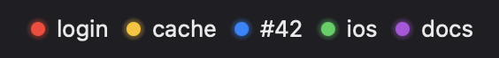
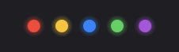
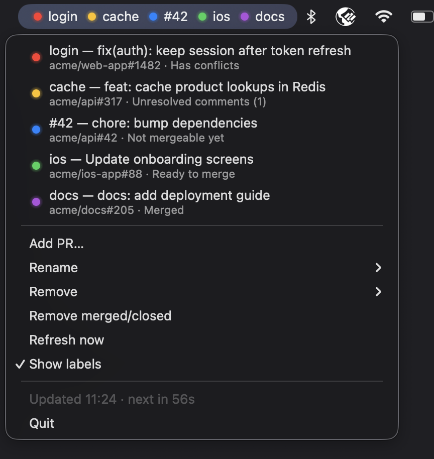

# menubar-pr-watchlist

Watches GitHub pull requests from the macOS menu bar (built with [rumps](https://github.com/jaredks/rumps)). A single menu bar item shows one LED per PR.

| With labels | Dots only |
|---|---|
|  |  |



## Features

- **PR LEDs**: one LED per watched PR in the menu bar; its colour says whether the PR has conflicts or failing checks, open review threads, is waiting, ready to merge, merged or closed. See [States](#states).
- **Running CI**: while CI checks are still running on a PR, its LED blinks, whatever its colour, and its menu entry says `CI running`. So a blue or yellow PR that is waiting for reviews can still turn red.
- **Watchlist**: **Add PR…** pre-fills a PR URL from the clipboard. **Remove** drops one PR, **Remove merged/closed** all finished ones at once.
- **Labels**: a short name next to each LED, e.g. `auth`. Type it after the URL when adding the PR, change it with **Rename**. Turn off **Show labels** for dots only.
- **PR details**: the menu lists each PR with its title, and its state on a second line. Click it to open the PR in the browser.
- **Notifications**: a banner in the top-right corner when a PR changes state, and when it gets a new unresolved review thread. Click it to open the PR in the browser. It goes away after 8 seconds (not while the mouse is on it) and isn't kept in Notification Center.
- **Refresh**: checked every 60 seconds; **Refresh now** checks right away.
- **Command line**: add, remove and list PRs from the terminal, also while the app runs, so Claude or a script can add PRs.

## States

Checked in this order; the first match wins.

| LED | Meaning |
|---|---|
| red | merge conflicts, or failing CI checks |
| yellow | unresolved review threads, or changes requested |
| blue | not mergeable yet (waiting for review, pending checks, draft, behind base) |
| green | ready to merge |
| purple | merged |
| gray | closed, not found / no access, or not checked yet |

An LED blinks while the PR's CI checks are running. A failed check turns it red right away, even while other checks still run.

When GitHub is still computing mergeability (right after a push), the previous state is kept.
A banner is shown whenever a PR changes state, and when a PR gets a new unresolved thread.

## How it works

- Polls every 60 s. All watched PRs are fetched in one GraphQL request. The menu shows when the next refresh is due.
- The token comes from the GitHub CLI (`gh auth token`), so run `gh auth login` once. The token is never stored.
- The watchlist lives in `~/Library/Application Support/menubar-pr-watchlist/config.json`. The app reloads it within a second when it changes on disk.

## Usage

- **Add PR…** pre-fills a PR URL from the clipboard. You can append a short label, e.g. `https://github.com/owner/repo/pull/123 auth`. Without a label, `#123` is used.
- Click a PR in the menu to open it in the browser.
- **Rename**, **Remove**, **Remove merged/closed**, **Refresh now**, **Show labels**.

### From the command line

Edits the watchlist, also while the app is running (so Claude or a script can add PRs):

```sh
.venv/bin/python pr_watchlist.py add https://github.com/owner/repo/pull/123 auth   # label is optional
.venv/bin/python pr_watchlist.py remove owner/repo#123 "other label"               # by URL, owner/repo#123 or label
.venv/bin/python pr_watchlist.py list
.venv/bin/python pr_watchlist.py help                                              # every command and its parameters
```

## Setup

Needs macOS 14 or later (for the second line in menu items).

```sh
python3 -m venv .venv
.venv/bin/pip install -r requirements.txt
```

## Tests

The logic is covered by tests: how a PR's state is worked out, when its LED blinks, and which banners are shown. They run on a scratch config, with GitHub stubbed. The menu isn't; check it by hand.

```sh
.venv/bin/pip install -r requirements-dev.txt
.venv/bin/python -m pytest tests
```

## Run

```sh
.venv/bin/python pr_watchlist.py
```

### Run without keeping a terminal open

Start it detached from the terminal. It keeps running after the terminal is closed, but not after a restart:

```sh
nohup .venv/bin/python pr_watchlist.py >/dev/null 2>&1 & disown
```

- `nohup` makes the app ignore the hang-up signal the terminal sends when it closes.
- `>/dev/null 2>&1` discards normal output and error output. The running app prints nothing but errors; to see them, run it in the foreground as above.
- `&` runs it in the background, and `disown` removes it from the shell's job list, so the shell doesn't warn about a running job when it closes.

Stop it with **Quit** in its menu.
