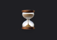
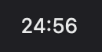
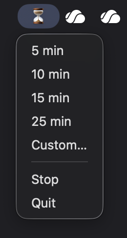

# menubar-timer

Countdown timer in the macOS menu bar (built with [rumps](https://github.com/jaredks/rumps)).

| Idle | Counting down | Menu |
|---|---|---|
|  |  |  |

## Features

- **Presets**: 5, 10, 15 or 25 minutes. Pick one in the menu; the time left counts down in the menu bar.
- **Custom time**: any number of minutes, decimals allowed (e.g. `1.5`). Click **Custom…**.
- **Time's up**: plays a sound and shows a notification.
- **Stop**: cancels the countdown. Picking a time while one runs starts over with the new time.

## Setup

```sh
python3 -m venv .venv
.venv/bin/pip install -r requirements.txt
```

## Run

```sh
.venv/bin/python timer.py
```

To keep it running after the terminal is closed, start it with `nohup` as described in [menubar-pr-watchlist](../menubar-pr-watchlist/README.md#run-without-keeping-a-terminal-open):

```sh
nohup .venv/bin/python timer.py >/dev/null 2>&1 & disown
```

Stop it with **Quit** in its menu.
